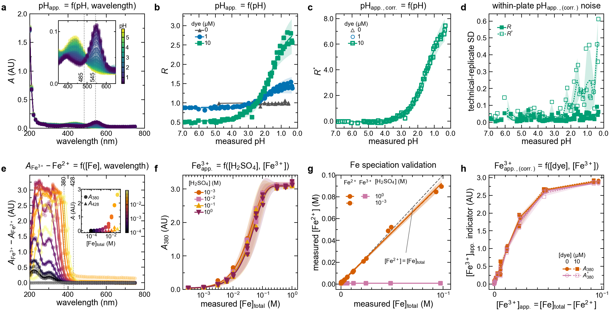

# Figure 1. Ratiometric pH and Fe³⁺ absorbance indicators in chemical standards.

**(a)** Spectra of H₂SO₄ standards containing nominally $10^{-5}$ M thymol blue, identified by measured pH; inset lines mark 485 and 545 nm.

**(b)** Measured $R=A_{545}/A_{485}$ versus pH.

**(c)** Scatter-corrected $R^{*}=A^{*}_{545}/A^{*}_{485}$ versus pH.

Gray triangles, blue circles, and green squares identify nominal 0, $10^{-6}$, and $10^{-5}$ M thymol blue, respectively; filled and open symbols denote measured and scatter-corrected ratios.

Curves are four-parameter logistic fits, except for measured ratios without dye, where lines connect means.

**(d)** Within-standard technical-well standard deviation (SD) at $10^{-5}$ M thymol blue; solid and dashed lines denote $R$ and $R^{*}$, respectively.

**(e)** Difference between Fe₂(SO₄)₃ and FeSO₄ spectra interpolated to matched measured total Fe concentrations in $10^{0}$ M H₂SO₄ without dye; the inset compares the selected-wavelength measurements at 380 and 428 nm.

**(f)** $A_{380}$ versus measured total Fe concentration at different nominal H₂SO₄ concentrations, with separate nonlinear fits; zero-Fe standards are omitted from the logarithmic axis.

**(g)** Mean Fe²⁺ concentration from replicate titrations of each standard versus measured total Fe concentration, with ordinary least-squares fits and a dashed identity line.

**(h)** Measured $A_{380}$ and scatter-corrected $A^{*}_{380}$ versus apparent Fe³⁺ concentration with or without dye.

Optical points show one estimate per physical microplate and standard, after averaging eligible wells or, in (d), calculating their SD. Points in (b–d) use each preparation’s measured pH. The fits use mean measured pH for each standard. In (e), each point subtracts the interpolated mean ferrous reference from one ferric microplate. The band combines ferric and ferrous measurement SDs.

Unfitted lines and bands indicate means $\pm$ SD; fitted bands indicate 95% confidence intervals.

[Figure (PDF)](Figure_1.pdf) · [Figure (PNG)](Figure_1.png) · [Plotted values (CSV)](Figure_1.csv)

**Technical Validation results** [S1](../supplementary_tables/Supplementary_Table_S1.md), [S2](../supplementary_tables/Supplementary_Table_S2.md), [S3](../supplementary_tables/Supplementary_Table_S3.md), [S4](../supplementary_tables/Supplementary_Table_S4.md), [S5](../supplementary_tables/Supplementary_Table_S5.md), [S6](../supplementary_tables/Supplementary_Table_S6.md), [S7](../supplementary_tables/Supplementary_Table_S7.md), [S24](../supplementary_tables/Supplementary_Table_S24.md), [S25](../supplementary_tables/Supplementary_Table_S25.md), [S26](../supplementary_tables/Supplementary_Table_S26.md).
