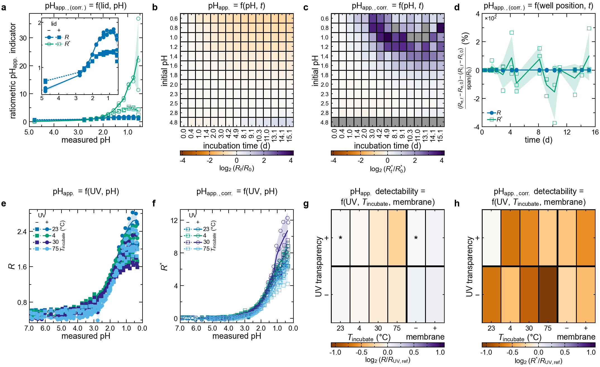

# Figure 2. Ratiometric pH indicator measurements across microplate configurations and incubation conditions.

**(a)** Measured thymol blue ratio $R=A_{545}/A_{485}$ and scatter-corrected $R^{*}$ versus measured pH in UV-transparent microplates with or without a lid; the inset enlarges the lower-response region.

**(b)** Mean $\log_2(R_t/R_0)$ during benchtop incubation in non-UV-transparent microplates.

**(c)** Mean $\log_2(R^{*}_t/R^{*}_0)$ under the same storage conditions.

**(d)** Edge–interior difference in the change from the initial indicator value, expressed as a percentage of the initial observed response span.

**(e)** Measured $R$ after sequential incubation at 23, 4, 30, and 75 °C in UV-transparent and non-UV-transparent microplates.

**(f)** Scatter-corrected $R^{*}$ after the same sequential incubations.

**(g)** Mean log₂ ratio of measured $R$ to the measured comparator $R$; asterisks identify the comparator conditions.

**(h)** Mean log₂ ratio of scatter-corrected $R^{*}$ to the same measured comparator $R$.

Temperature comparisons use the initial UV-transparent acquisition at 23 °C; membrane comparisons use the overnight UV-transparent acquisition without membrane.

Gray heatmap cells indicate unavailable ratios. In (a, d–f), each point represents one physical microplate. Lines and shading show the mean and between-microplate standard deviation at each standard or acquisition.

[Figure (PDF)](Figure_2.pdf) · [Figure (PNG)](Figure_2.png) · [Plotted values (CSV)](Figure_2.csv)

**Technical Validation results** [S8](../supplementary_tables/Supplementary_Table_S8.md), [S9](../supplementary_tables/Supplementary_Table_S9.md), [S10](../supplementary_tables/Supplementary_Table_S10.md), [S27](../supplementary_tables/Supplementary_Table_S27.md), [S28](../supplementary_tables/Supplementary_Table_S28.md).
