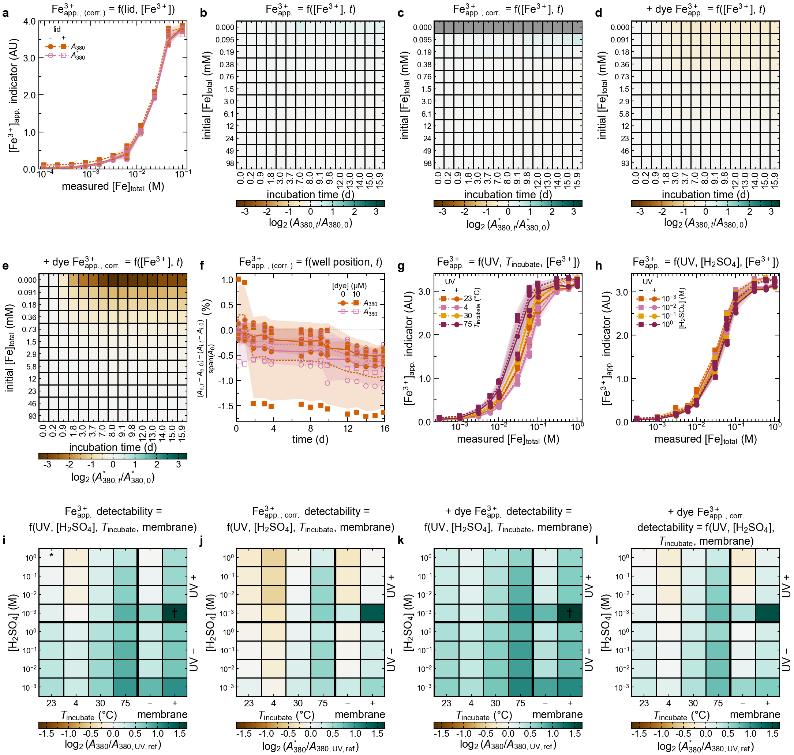

# Figure 3. Fe³⁺ absorbance indicator measurements across microplate configurations and incubation conditions.

**(a)** Measured $A_{380}$ and scatter-corrected $A^{*}_{380}$ versus measured total Fe concentration with or without a lid.

**(b)** Mean $\log_2(A_{380,t}/A_{380,0})$ during benchtop incubation without dye.

**(c)** Mean $\log_2(A^{*}_{380,t}/A^{*}_{380,0})$ during benchtop incubation without dye.

**(d)** Mean $\log_2(A_{380,t}/A_{380,0})$ during benchtop incubation with nominally $10^{-5}$ M thymol blue.

**(e)** Mean $\log_2(A^{*}_{380,t}/A^{*}_{380,0})$ during benchtop incubation with nominally $10^{-5}$ M thymol blue.

**(f)** Edge–interior difference in the change from initial $A^{(*)}_{380}$, expressed as a percentage of the initial observed response span, for both dye conditions.

**(g)** Measured $A_{380}$ during sequential temperature incubations in $10^{0}$ M H₂SO₄ without dye.

**(h)** Measured $A_{380}$ versus measured total Fe concentration at different nominal H₂SO₄ concentrations in UV-transparent and non-UV-transparent microplates.

**(i)** Mean log₂ ratio of measured $A_{380}$ without dye to the common comparator; the asterisk identifies the comparator condition.

**(j)** Corresponding ratio for scatter-corrected $A^{*}_{380}$ without dye.

**(k)** Corresponding ratio for measured $A_{380}$ with nominally $10^{-5}$ M thymol blue.

**(l)** Corresponding ratio for scatter-corrected $A^{*}_{380}$ with nominally $10^{-5}$ M thymol blue.

The common comparator is initial measured $A_{380}$ in UV-transparent microplates without dye at 23 °C in $10^{0}$ M H₂SO₄, interpolated to matched measured total Fe concentrations.

Gray heatmap cells indicate unavailable ratios. Daggers identify the low-acid membrane acquisition with reversed concentration ordering.

In (a, f–h), points represent physical microplates and lines and shading show their mean $\pm$ standard deviation. Lid and storage comparisons use repeated microplates of shared preparations. Temperature and acid-background comparisons use independently prepared standards.

[Figure (PDF)](Figure_3.pdf) · [Figure (PNG)](Figure_3.png) · [Plotted values (CSV)](Figure_3.csv)

**Technical Validation results** [S8](../supplementary_tables/Supplementary_Table_S8.md), [S9](../supplementary_tables/Supplementary_Table_S9.md), [S10](../supplementary_tables/Supplementary_Table_S10.md), [S27](../supplementary_tables/Supplementary_Table_S27.md).
