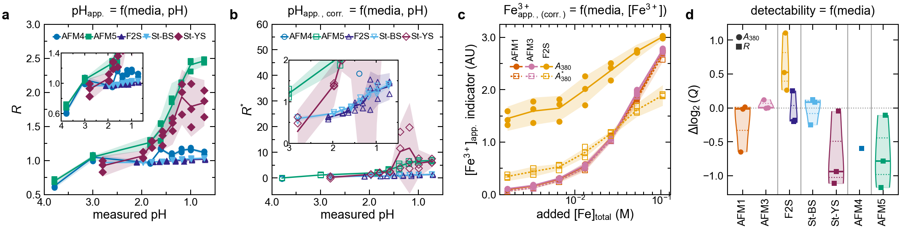

# Figure 4. Ratiometric pH and Fe³⁺ absorbance indicators in acidophile media.

**(a)** Measured thymol blue ratio $R=A_{545}/A_{485}$ versus measured pH in AFM4, AFM5, F2S, and Starkey (St) medium containing brown or yellow S⁰, abbreviated bS⁰ and yS⁰, respectively.

**(b)** Scatter-corrected $R^{*}$ versus measured pH in the same media; the insets enlarge the lower-response regions.

**(c)** Measured $A_{380}$ and scatter-corrected $A^{*}_{380}$ versus additional total Fe supplied as Fe₂(SO₄)₃ to AFM1, AFM3, and F2S without dye; the horizontal axis excludes Fe already present in each medium.

In (a–c), each point is the mean of eligible wells for one standard on one physical microplate. Lines show means across eligible wells and shading shows their pooled technical standard deviation (SD). Microplates sharing a standard preparation can give overlapping points.

**(d)** Log₂ ratio of the scatter-corrected to measured response-span-to-SD ratio, $\log_2(Q^{*}/Q)$, calculated using the same eligible wells for each pair.

Violin distributions, median and quartile marks, and individual microplate estimates summarize technical precision; AFM4 lacks sufficient eligible estimates for an across-microplate SD or hypothesis test.

Vertical separators distinguish Fe²⁺ media (AFM1 and AFM3), medium containing Fe²⁺ and bS⁰ (F2S), bS⁰ and yS⁰ media (St), S₂O₃²⁻ medium (AFM4), and S₄O₆²⁻ medium (AFM5).

In (d), circles denote $A_{380}$ and squares denote $R$. F2S includes both indicators.

[Figure (PDF)](Figure_4.pdf) · [Figure (PNG)](Figure_4.png) · [Plotted values (CSV)](Figure_4.csv)

**Technical Validation results** [S11](../supplementary_tables/Supplementary_Table_S11.md), [S12](../supplementary_tables/Supplementary_Table_S12.md), [S26](../supplementary_tables/Supplementary_Table_S26.md), [S28](../supplementary_tables/Supplementary_Table_S28.md).
