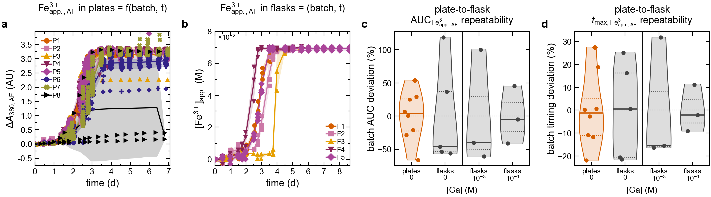

# Figure 5. Between-batch variation in microplate and shake-flask measurements for *A. ferrooxidans*.

**(a)** Biotic change from initial $A_{380}$ in no-additive AFM1 microplate cultures across batches P1–P8, without abiotic subtraction.

**(b)** Apparent Fe³⁺ generation estimated from Fe²⁺ depletion in no-additive AFM1 shake-flask cultures across batches F1–F5.

Points represent independent microplate or shake-flask estimates; lines and shaded regions indicate within-batch means $\pm$ standard deviation (SD).

**(c)** Between-batch percentage deviations in area under the curve (AUC) for the corresponding indicator or apparent Fe³⁺ generation, including shake-flask treatments with $10^{-3}$ or $10^{-1}$ M Ga₂(SO₄)₃ on a cation basis.

**(d)** Corresponding percentage deviations in time to first observed maximum.

AUC extends from the initial measurement to the first observed maximum of each trajectory.

Violin distributions show median and quartile marks, with each point representing an experimental batch.

Diamonds identify the grouped batch containing no-additive control conditions from iodate experiments.

A vertical separator distinguishes no-additive control conditions from Ga₂(SO₄)₃ treatments.

[Figure (PDF)](Figure_5.pdf) · [Figure (PNG)](Figure_5.png) · [Plotted values (CSV)](Figure_5.csv)

**Technical Validation results** [S13](../supplementary_tables/Supplementary_Table_S13.md), [S14](../supplementary_tables/Supplementary_Table_S14.md), [S22](../supplementary_tables/Supplementary_Table_S22.md), [S23](../supplementary_tables/Supplementary_Table_S23.md).
