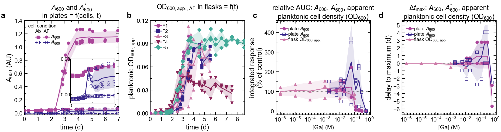

# Figure 6. Microplate absorbance and apparent planktonic cell density in shake flasks for *A. ferrooxidans*.

**(a)** Measured $A_{600}$ and scatter-corrected $A^{*}_{600}$ for paired no-additive *A. ferrooxidans* (AF) and abiotic (Ab) conditions; open symbols denote scatter correction. The inset enlarges both Ab series and the scatter-corrected AF series.

**(b)** Fluorescence-derived apparent planktonic cell density expressed as $\mathrm{OD}_{600}$ in no-additive shake-flask cultures, after abiotic-control subtraction.

Points represent independent microplate or shake-flask estimates; lines and shaded regions indicate within-batch means $\pm$ standard deviation (SD).

**(c)** Area under the curve (AUC) as a percentage of the same-batch, same-measurement no-additive control mean, versus Ga₂(SO₄)₃ treatment concentration on a cation basis.

**(d)** Treatment-minus-control differences in time to first observed maximum for the same measurement types.

Concentration-response lines connect within-batch means at the respective nominal concentrations or concentrations calculated from measured stocks; shaded regions indicate within-batch vessel SD.

The no-additive control is omitted from the logarithmic concentration axis.

[Figure (PDF)](Figure_6.pdf) · [Figure (PNG)](Figure_6.png) · [Plotted values (CSV)](Figure_6.csv)

**Technical Validation results** [S15](../supplementary_tables/Supplementary_Table_S15.md).
