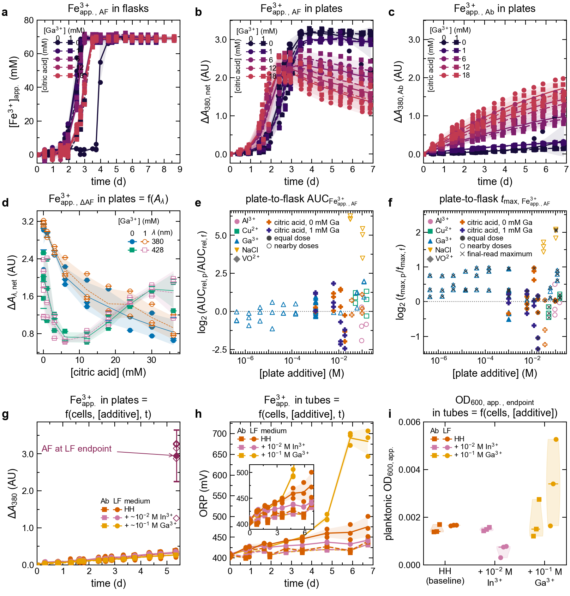

# Figure 7. Microplate and shake-flask comparisons and *L. ferriphilum* validation measurements.

**(a)** Shake-flask apparent Fe³⁺ generation estimated from Fe²⁺ depletion for *A. ferrooxidans* (AF) citric-acid/Ga₂(SO₄)₃ conditions.

**(b)** Net biotic microplate $\Delta A_{380}$ for the same treatment formulations.

**(c)** Corresponding abiotic (Ab) $\Delta A_{380}$.

In (a–c), color identifies citric acid concentration; circles/solid lines and squares/dashed lines denote 0 and 1 mM added Ga³⁺, respectively. Net change subtracts mean condition-matched abiotic change from biotic change since the initial measurement.

**(d)** Net changes at the final acquisition at 380 nm (circles) and 428 nm (squares) versus citric acid; filled/open symbols and solid/dashed lines denote 0 or 1 mM added Ga³⁺, respectively.

Points show paired microplates. Horizontal ticks show batch means. Lines and bands show the equally weighted mean $\pm$ between-batch standard deviation (SD).

**(e)** Log₂ microplate/shake-flask ratio of relative area under the curve (AUC), $\log_2(\mathrm{AUC}_{\mathrm{rel,p}}/\mathrm{AUC}_{\mathrm{rel,f}})$, versus microplate additive concentration.

**(f)** Log₂ microplate/shake-flask ratio of mean time to first observed maximum, $\log_2(\bar{t}_{\max,\mathrm{p}}/\bar{t}_{\max,\mathrm{f}})$, versus microplate additive concentration.

Relative AUC is the percentage of the same-batch no-additive control mean.

Filled/open symbols denote equal/neighboring concentrations; crosses identify maxima at the final acquisition.

Labels Al³⁺, Cu²⁺, Ga³⁺, and VO²⁺ denote added Al₂(SO₄)₃, CuSO₄, Ga₂(SO₄)₃, and VOSO₄, respectively; citric acid series contain 0 or 1 mM added Ga³⁺.

Metal-salt concentrations use a cation basis.

**(g)** *L. ferriphilum* (LF) and Ab changes from initial $A_{380}$ at $1.428\times10^{-1}$ M added Ga³⁺ or $6.22\times10^{-3}$ M added In³⁺, with HH controls; Open diamonds show the eight AF batch means interpolated at 5.366 d. The filled diamond and error bar show their mean $\pm$ SD.

**(h)** Culture-tube oxidation–reduction potential relative to Ag/AgCl with $3\times10^{0}$ M KCl, using fresh LF starters; diamonds denote shared starting-medium measurements.

**(i)** Fluorescence-derived apparent planktonic cell density expressed as $\mathrm{OD}_{600}$ using the AF conversion, for the fresh-starter culture tubes; violins show individual culture tubes and medians.

In trajectories and final absorbance comparisons, points represent vessels and lines and bands show means $\pm$ SD.

For LF comparisons, orange, pink, and yellow denote HH, In₂(SO₄)₃, and Ga₂(SO₄)₃, respectively; circles/squares and solid/dashed lines distinguish LF/Ab.

[Figure (PDF)](Figure_7.pdf) · [Figure (PNG)](Figure_7.png) · [Plotted values (CSV)](Figure_7.csv)

**Technical Validation results** [S16](../supplementary_tables/Supplementary_Table_S16.md), [S17](../supplementary_tables/Supplementary_Table_S17.md), [S18](../supplementary_tables/Supplementary_Table_S18.md), [S19](../supplementary_tables/Supplementary_Table_S19.md), [S29](../supplementary_tables/Supplementary_Table_S29.md), [S30](../supplementary_tables/Supplementary_Table_S30.md), [S31](../supplementary_tables/Supplementary_Table_S31.md).
