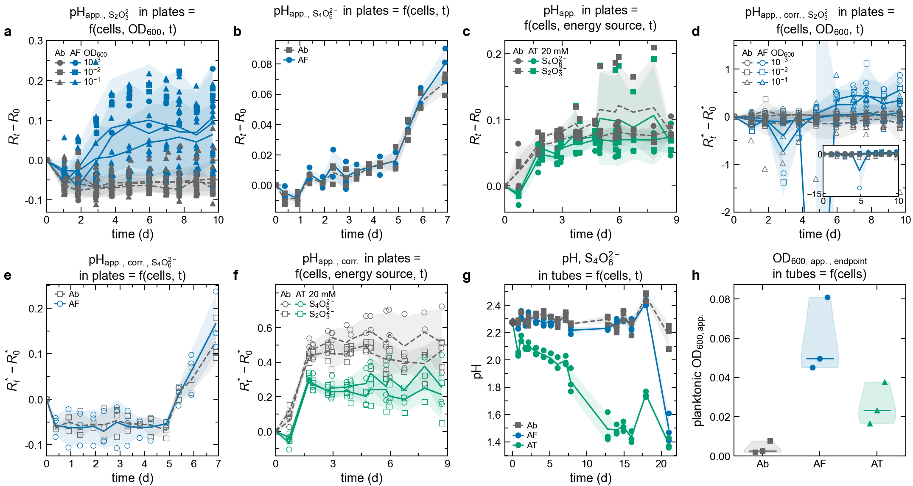

# Figure 8. Ratiometric pH indicators in soluble-S microplate cultures and S₄O₆²⁻ culture-tube validation.

**(a)** Changes from the initial measured thymol blue ratio $R=A_{545}/A_{485}$ for *A. ferrooxidans* (AF) supplied with S₂O₃²⁻.

**(b)** Changes from initial measured $R$ for AF supplied with S₄O₆²⁻.

**(c)** Changes from initial measured $R$ for *A. thiooxidans* (AT) supplied with S₂O₃²⁻ or S₄O₆²⁻.

**(d)** Changes from initial scatter-corrected $R^{*}$ for AF supplied with S₂O₃²⁻; the inset shows the full indicator range.

**(e)** Changes from initial scatter-corrected $R^{*}$ for AF supplied with S₄O₆²⁻.

**(f)** Changes from initial scatter-corrected $R^{*}$ for AT supplied with S₂O₃²⁻ or S₄O₆²⁻.

Nominal substrate concentrations before dye addition were $2.015\times10^{-2}$ M S₂O₃²⁻ for AF, $5\times10^{-3}$ M S₄O₆²⁻ for AF, and $2\times10^{-2}$ M of either substrate for AT; AT treatments contained $10^{-5}$ M nominal added H₂SO₄.

Inoculum $\mathrm{OD}_{600}$ values also refer to the mixtures before dye addition; Ab denotes abiotic controls.

Filled and open symbols denote measured and scatter-corrected ratios, respectively. Microplate points represent within-plate means; lines and shaded regions show means $\pm$ standard deviation (SD) across eligible microplates, with gaps where the required measurements were unavailable.

**(g)** Measured pH trajectories in TB-04 culture tubes containing 5 mM K₂S₄O₆ without added Ga₂(SO₄)₃; circles and squares show individual tubes, diamonds show each shared starting-medium measurement once, and lines and bands show means $\pm$ SD.

**(h)** Apparent planktonic cell density expressed as $\mathrm{OD}_{600}$ at the final culture-tube acquisition, using the AF-derived fluorescence conversion; violins show individual measurements and median marks.

Gray, blue, and green identify Ab, AF, and AT, respectively.

[Figure (PDF)](Figure_8.pdf) · [Figure (PNG)](Figure_8.png) · [Plotted values (CSV)](Figure_8.csv)

**Technical Validation results** [S19](../supplementary_tables/Supplementary_Table_S19.md), [S20](../supplementary_tables/Supplementary_Table_S20.md), [S21](../supplementary_tables/Supplementary_Table_S21.md), [S28](../supplementary_tables/Supplementary_Table_S28.md), [S32](../supplementary_tables/Supplementary_Table_S32.md).
